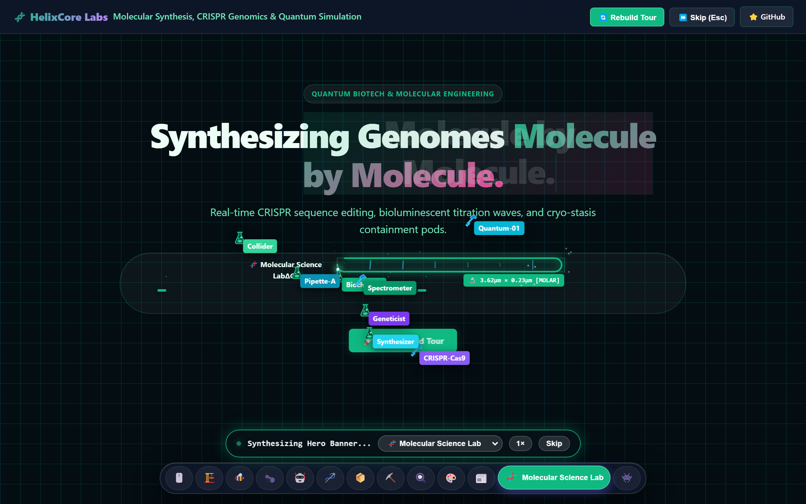

# AAA Swarm 🐝 — Multiplayer "Page Rebuild" Guided Tour

[](SKILL.md)
[](#-12-authentic-industry-themes)
[-green.svg)](#)
[](LICENSE)

An interactive, high-impact multiplayer cursor rebuild experience for modern web applications, inspired by Dhvanil Patel's iconic portfolio tour. 

A collaborative flock of labeled agent cursors (`Designer`, `Dev`, `AAA`, `Artist`, `PM`, `3D`, `Biochemist`, etc.) works in real time to assemble your web page piece by piece over an authentic blueprint or themed matrix background. The camera smoothly guides visitors down section by section as each is physically constructed, then glides back to the top once finished.

**Zero external dependencies. Pure vanilla JavaScript and CSS.**

---

## 💡 Two Ways to Add Swarm to Your Site

You can integrate AAA Swarm into your website in two ways:

1. [🤖 **As an AI Agent Skill (Automated & Recommended)**](#-way-1-use-as-an-ai-agent-skill-fastest--easiest) — If you use Claude Code, OpenAI Codex, Google Antigravity, Cursor, Windsurf, or OpenCode, the agent installs, configures, and tests the tour in your project automatically.
2. [🛠️ **Manual Integration with Advanced Options**](#-way-2-manual-integration--advanced-developer-guide) — If you are building manually without an agent or need advanced programmatic control, lifecycle hooks, custom themes, or framework integrations.

---

## 🎬 Live Showcase

Experience autonomous agent swarms assembling modern websites live across 12 authentic industry themes:


### 🛸 Floating Bottom Theme Switcher Dock
Hover any icon to reveal its industry label; click to instantly rebuild the entire page in that theme's physical choreography:


* **Interactive Live Demo**: Open `index.html` locally or deploy directly to GitHub Pages (`.nojekyll` included).

---

## 🤖 Way 1: Use as an AI Agent Skill (Fastest & Easiest)

`aaa-swarm` is formatted as an open **Agent Skill** (`SKILL.md` & `AGENTS.md`). Any AI coding assistant reading your repository can automatically inspect your HTML/React/Vue/Svelte code and install the effect in seconds.

### 1. Install the Skill into Your Agent

Install globally so the skill is available in any terminal or project:

```bash
# Claude Code (Anthropic)
git clone https://github.com/theaaa-studio/aaa-swarm.git ~/.claude/skills/aaa-swarm

# OpenAI Codex
git clone https://github.com/theaaa-studio/aaa-swarm.git ~/.codex/skills/aaa-swarm

# Google Antigravity / Gemini
git clone https://github.com/theaaa-studio/aaa-swarm.git ~/.gemini/config/skills/aaa-swarm

# OpenCode / OpenHands / Generic Agents
git clone https://github.com/theaaa-studio/aaa-swarm.git ~/.agents/skills/aaa-swarm
```

Or copy the `aaa-swarm/` folder into your project's local `.claude/skills/`, `.codex/skills/`, or `.agents/skills/` directory.

### 2. Prompt Your AI Agent

Simply ask your agent:

> *"Add the aaa-swarm guided tour to my website. Use the cyber-nanobots theme locked to my brand and run it once per session."*

### 3. Agent Confirmation Protocol (Mandatory Step 0)
When invoked, the skill instructs your AI assistant to confirm your preferences before touching any code:
- **Theme Choice**: Single locked theme (e.g. `cyber-nanobots` for AI, `construction` for hardware, `kitchen` for dining) vs. Multi-Theme Dock with floating bottom switcher vs. Mixed themes per section (`data-swarm-theme`).
- **Trigger & Frequency**: Run automatically on load, run once per session (`oncePerSession: true`), or trigger on button click.
- **Framework**: Vanilla HTML, React/Next.js, Vue/Nuxt, Svelte/SvelteKit, or Astro.

The agent copies `assets/swarm.js` and `assets/swarm.css`, links them with proper SSR/hydration guards, and verifies the tour runs smoothly with zero layout reflow.

---

## 🛠️ Way 2: Manual Integration & Advanced Developer Guide

If you prefer to integrate Swarm manually without an AI agent, or require advanced customizations, follow this complete developer reference.

### 1. Copy Assets into Your Project

Download or copy `assets/swarm.css` and `assets/swarm.js` into your project:

```bash
my-project/
├── css/
│   └── swarm.css     # Swarm visual styles & 12 theme themes
├── js/
│   └── swarm.js      # UMD/SSR-safe tour engine
└── index.html        # Your page
```

### 2. Include in Your HTML / Template

Include `swarm.css` in your `<head>`:
```html
<link rel="stylesheet" href="css/swarm.css">
```

Include `swarm.js` before the closing `</body>`:
```html
<script defer src="js/swarm.js"></script>
```

### 3. Mark Sections for Guided Tour

Ensure the content you want reconstructed is wrapped inside `<section>` elements (or elements with `data-swarm-section`):

```html
<main id="main">
  <section id="hero">
    <h1>Autonomous Guided Tour</h1>
    <p>Watch your page construct in real time.</p>
  </section>

  <section id="features">
    <h2>Core Features</h2>
    <div class="card">Feature 1</div>
    <div class="card">Feature 2</div>
  </section>

  <section id="pricing">
    <h2>Simple Pricing</h2>
    <div class="pricing-card">Pro Plan - $29/mo</div>
  </section>
</main>
```

### 4. Basic Initialization

```javascript
window.addEventListener("DOMContentLoaded", () => {
  // Allow fonts and WebGL / layout to settle baseline geometry
  setTimeout(() => {
    if (window.Swarm) {
      window.Swarm.init({
        root: "main",
        theme: "cyber-nanobots",
        themes: ["cyber-nanobots"], // Locking to 1 theme hides switcher dock
        oncePerSession: true        // Don't interrupt returning visitors
      });
    }
  }, 100);
});
```

---

## ⚙️ Advanced Configuration Options & Full API

The engine exposes a global `window.Swarm` object (also exported as a UMD / CommonJS / ES-compatible module):

```typescript
const instance = window.Swarm.init(options);
```

### Full Options Reference

| Option | Type | Default | Description |
|---|---|---|---|
| `root` | `string \| HTMLElement` | `"main"` | Selector or DOM element to snapshot (supports React `ref.current` / Vue `ref.value`). |
| `theme` | `string` | `"default"` | Active initial theme ID (e.g. `"cyber-nanobots"`, `"construction"`, `"science"`). |
| `themes` | `Array<string>` | `null` (All) | Whitelist of allowed themes. **Passing an array with 1 theme locks the site and completely hides the theme switcher UI.** |
| `showDock` | `boolean \| "auto"` | `"auto"` | Controls the floating bottom icon dock (`true`, `false`, or `"auto"`: visible when >1 theme). |
| `showToolbar` | `boolean` | `true` | Controls floating status HUD pill with speed toggle, live step counter, and skip button. |
| `speed` | `1 \| 2 \| 3` | `1` | Initial speed multiplier (`1×`, `2×`, or `3×`). |
| `agents` | `number` | `8` (desk) / `4` (mob) | Concurrent worker cursors (`3` to `12`). Automatically scales down on screens `<= 640px`. |
| `oncePerSession` | `boolean` | `false` | When `true`, records completion in `sessionStorage` and skips rebuild on subsequent navigations. |
| `sectionSelector` | `string` | `"section, [data-swarm-section]"` | CSS selector identifying tour stops. |
| `onComplete` | `Function` | `null` | Callback executed when all sections finish assembling and camera glides back to `(0,0)`. |

### Advanced Methods & Programmatic Lifecycle

```javascript
// 1. Check if rebuild is actively in progress
if (window.Swarm.isRunning()) {
  console.log("Tour active!");
}

// 2. Skip tour instantly (unveils all pending DOM elements immediately)
window.Swarm.skip();

// 3. Replay tour with custom runtime options
window.Swarm.replay({
  theme: "construction",
  speed: 2,
  agents: 10
});

// 4. Switch theme dynamically at runtime
window.Swarm.setTheme("science");

// 5. Jump tour directly to a specific section by element ID
window.Swarm.triggerSectionById("pricing");

// 6. Complete cleanup (tears down canvases, overlays, docks, and event listeners)
window.Swarm.destroy();
```

---

## 🎨 Advanced Customization Techniques

### 1. Mixed Themes Per Section (`data-swarm-theme`)
You can mix themes across sections! Add `data-swarm-theme` to any section to override the global theme for that specific part of your page:

```html
<main id="main">
  <!-- Hero constructs with AI Cyber Nanobots -->
  <section id="hero" data-swarm-theme="cyber-nanobots">
    <h1>Next-Gen Cloud AI</h1>
  </section>

  <!-- Architecture constructs with Scaffolding & Blowtorches -->
  <section id="infra" data-swarm-theme="construction">
    <h2>Heavy Infrastructure</h2>
  </section>

  <!-- Research constructs with Molecular Discovery Titration -->
  <section id="research" data-swarm-theme="science">
    <h2>Biotech Research</h2>
  </section>
</main>
```

### 2. Register Custom Brand Themes (`Swarm.registerTheme`)
Define your own fully branded theme with custom cursor names, palette colors, tools, and dimensions without editing library source files:

```javascript
window.Swarm.registerTheme("my-fintech", {
  id: "my-fintech",
  label: "Apex Fintech",
  emoji: "💳",
  subtitle: "High-Frequency Blockchain Settlement",
  names: ["Ledger-01", "Validator", "SmartContract", "SecOps"],
  colors: ["#10b981", "#06b6d4", "#3b82f6", "#6366f1"],
  renderIcon: (tool) => tool === "pen" ? "🖋️" : "💼",
  dimensionUnit: (w, h) => `💰 $${Math.round(w * h * 12)} [VOLUME]`,
  statusPrefix: "Auditing & Minting",
  speedScale: 0.9,
  boxClass: "is-wireframe"
});

// Initialize with your new theme
window.Swarm.init({ theme: "my-fintech", themes: ["my-fintech"] });
```

### 3. Exclude Fixed Headers, Modals & Audio Players
Elements that should remain visible and un-snapshotted during the rebuild (such as fixed navigation headers, floating chats, or background audio widgets) can either:
- Be placed **outside** the `<main>` container root.
- Or carry the class `.swarm-no-tour`:

```html
<header class="navbar swarm-no-tour">
  <a href="/">Brand Logo</a>
  <button onclick="window.Swarm.replay()">🔄 Replay Tour</button>
</header>
```

### 4. Custom Section Labels in Status HUD
By default, the status pill derives section names from their `id` or headings. You can explicitly set friendly names via `aria-label`:

```html
<section id="sec-3" aria-label="Enterprise Security Architecture">
  <!-- The status HUD will display: "Constructing Enterprise Security Architecture..." -->
</section>
```

---

## ⚛️ Framework Integration Recipes

### React 18 / 19 & Next.js (App Router or Pages)

```tsx
"use client";

import { useEffect, useRef } from "react";
import Script from "next/script";

export default function LandingPage() {
  const mainRef = useRef<HTMLElement>(null);

  useEffect(() => {
    let tourInstance: any = null;

    const startTour = () => {
      if (typeof window !== "undefined" && (window as any).Swarm && mainRef.current) {
        tourInstance = (window as any).Swarm.init({
          root: mainRef.current,
          theme: "cyber-nanobots",
          themes: ["cyber-nanobots"],
          oncePerSession: true
        });
      }
    };

    if (document.readyState === "complete") {
      startTour();
    } else {
      window.addEventListener("DOMContentLoaded", startTour);
    }

    return () => {
      if (tourInstance) tourInstance.destroy();
      else if ((window as any).Swarm) (window as any).Swarm.destroy();
    };
  }, []);

  return (
    <>
      <link rel="stylesheet" href="/css/swarm.css" />
      <Script src="/js/swarm.js" strategy="afterInteractive" />

      <main ref={mainRef}>
        <section id="hero">...</section>
        <section id="features">...</section>
      </main>
    </>
  );
}
```

### Vue 3 & Nuxt 3 (Composition API)

```vue
<script setup>
import { ref, onMounted, onBeforeUnmount } from "vue";

const mainRoot = ref(null);
let tour = null;

onMounted(() => {
  if (typeof window !== "undefined" && window.Swarm && mainRoot.value) {
    tour = window.Swarm.init({
      root: mainRoot.value,
      theme: "construction",
      themes: ["construction"],
      oncePerSession: true
    });
  }
});

onBeforeUnmount(() => {
  if (tour) tour.destroy();
});
</script>

<template>
  <main ref="mainRoot">
    <section id="hero">...</section>
    <section id="showcase">...</section>
  </main>
</template>
```

### Svelte 5 / SvelteKit

```svelte
<script>
  import { onMount, onDestroy } from "svelte";

  let mainRoot;
  let tour;

  onMount(() => {
    if (typeof window !== "undefined" && window.Swarm && mainRoot) {
      tour = window.Swarm.init({
        root: mainRoot,
        theme: "science",
        themes: ["science"]
      });
    }
  });

  onDestroy(() => {
    if (tour) tour.destroy();
  });
</script>

<svelte:head>
  <link rel="stylesheet" href="/css/swarm.css" />
  <script defer src="/js/swarm.js"></script>
</svelte:head>

<main bind:this={mainRoot}>
  <section id="hero">...</section>
  <section id="discovery">...</section>
</main>
```

### Astro

```astro
---
// src/pages/index.astro
---
<html lang="en">
  <head>
    <link rel="stylesheet" href="/css/swarm.css" />
  </head>
  <body>
    <main id="main">
      <section id="hero">...</section>
      <section id="pricing">...</section>
    </main>

    <script is:inline src="/js/swarm.js"></script>
    <script is:inline>
      window.addEventListener("DOMContentLoaded", () => {
        if (window.Swarm) {
          window.Swarm.init({ root: "main", theme: "cyber-nanobots" });
        }
      });
    </script>
  </body>
</html>
```

---

## 🛠️ Interactive Configurator Studio

Need an instant snippet for your stack? The demo page includes an interactive **Configurator & Framework Studio** (`#integration`) that lets you configure options, test them live, and copy production-ready code:


---

## 🎨 12 Authentic Industry Themes

Each theme features completely bespoke physical construction choreographies, custom vector tools, particle sparks, and sound effects:

### 1. Heavy Construction & Engineering (`construction`)
Scaffolding vertical poles, blowtorch welder sparks, hydraulic concrete pour, and crane cargo crate drops:


### 2. AI, Cloud & Cybersecurity (`cyber-nanobots`)
Micro-drones with dual vertical laser scanbars, PCB copper traces with solder pads, and Matrix hex decryption:


### 3. Voxel Craft & Gaming (`voxel-craft`)
Pixelated pickaxes swinging as 16x16 voxel blocks snap with physics bounce, Redstone wire border glow, and treasure chest unpacks:


### 4. Quantum Creation & Molecular Discovery Lab (`science`)
Quantum collider discovery beam sweeps across, generating molecular synthesis reactions with spinning electron orbital shells, chemical formula tags, effervescent bubbling titration, and cryo-specimen unlocks:


### Complete 12-Theme Physical Choreography Matrix

| Theme ID | Industry Niche & Brand | 5-Phase Physical Choreography |
|---|---|---|
| `default` | SaaS, Digital Product Design (`AAA Studio`) | Blueprint bounding box, vector pen crosshairs, grid fade, terminal caret, crop frame |
| `construction` | Heavy Civil & Structural Engineering (`APEX Structural`) | Scaffolding vertical poles, blowtorch welder sparks, wet concrete pour, crane wooden crate drop |
| `beehive` | Organic Biotech, Honey & Apiculture (`Apis BioLabs`) | Figure-8 beeswax bloom, dripping amber honey drops, crystallization fill, scout bee waggle dance, honeycomb wax cap unseal |
| `ant-colony` | Logistics, DevOps & Haulage (`Myrmex Logistics`) | Forager pheromone trench haul, mandible boundary wall, soil tile packing, ant letter delivery, 8-ant heavy cargo lift |
| `cyber-nanobots` | AI, Cloud & Photolithography (`Nexus-9 AI`) | Quadcopter dual vertical laser scanbars, PCB copper routing with solder pads, Matrix hex decrypt, 3D laser sinter sweep |
| `atelier` | Haute Couture & Luxury Tailoring (`Maison Lumière`) | Fabric bolt unroll, running needle bob stitches with silk thread, drape down, monogram embroidery, Polaroid brass pushpin |
| `warehouse` | E-Commerce, AGV & Cross-Dock (`KivaFlow Logistics`) | Kraft tape carton dispensing, barcode scanner sweep + FRAGILE stamp, 3D cardboard flaps folding, forklift pallet delivery |
| `voxel-craft` | 3D Voxel Gaming & EdTech (`BlockForge Engine`) | 16x16 voxel block snap with bounce, Redstone wire border glow, cubic block stack, 8-bit RPG text ticker, bouncing treasure chest |
| `kitchen` | Artisanal Bakery & Grand Bistro (`L'Étoile Dorée`) | Rolling pin dough flattening, fluted pastry cream piping, blowtorch caramelization, chocolate syrup drizzle, silver cloche steam lift |
| `street-art` | Urban Murals & Creative Agencies (`KRYLON Syndicate`) | Diagonal wheatpaste strokes, fat-cap aerosol spray with vertical paint runs, squeegee poster press, industrial stencil, slap-sticker slam |
| `press-room` | Broadsheet Journalism & Legal/Finance (`The Daily Chronicle`) | Iron movable-type chase frame clamp ┼, ink brayer roller sweep, mechanical typewriter hammer punch, CMYK halftone plate alignment |
| `science` | Quantum Discovery & Creation Lab (`EurekaBio Discovery`) | Collider discovery beam, spinning electron orbital shells, chemical formula tags, effervescent bubbling titration, cryo-specimen reticle unseal |

---

## ✨ Features & Architecture Guardrails

- **📐 CAD Blueprint & Hazard Stripe Canvas**: Authentic blueprint grid background with metric scales, technical stamps, and perimeter hazard warning stripes (`#f59e0b` / `#1e293b`).
- **🛠️ 5 Complete Physical Assembly Phases (Radically Customized Across 12 Themes)**:
  - **`dragBox` (Layout Framing)**: Rising scaffolding vertical poles (`construction`), figure-8 honeycomb wax bloom (`beehive`), pheromone trench haul (`ant-colony`), dual drone laser scanbar sweep (`cyber-nanobots`), fabric bolt unroll (`atelier`), kraft tape carton dispensing (`warehouse`), voxel tile pop (`voxel-craft`), rolling pin dough flattening (`kitchen`), diagonal wheatpaste strokes (`street-art`), movable-type chase frame clamp (`press-room`), quantum collider discovery sweep with electron orbital rings (`science`).
  - **`traceBorder` (Perimeter Sealing)**: White-hot welder blowtorch sparks (`construction`), dripping amber honey droplets (`beehive`), marching ant mandible wall (`ant-colony`), PCB copper routing with solder pads (`cyber-nanobots`), needle running stitches with silk thread (`atelier`), barcode scanner sweep + FRAGILE stamp (`warehouse`), redstone wire glow (`voxel-craft`), fluted pastry cream piping (`kitchen`), aerosol neon spray with vertical paint runs (`street-art`), fountain pen ruling with corner crop-marks ┼ (`press-room`), spectrometer ion laser perimeter with snapping atomic orbital nodes (`science`).
  - **`fillBox` (Surface Solidify)**: Hydraulic wet concrete pour, liquid amber honey crystallization, leaf & soil tile packing, Matrix glitch voxel materialize, silk cloth drape down, 3D cardboard flaps folding, 16x16 pixel block stack, kitchen blowtorch caramelization, squeegee poster press, ink brayer roller sheet sweep, effervescent bubbling titration reaction (`science`).
  - **`typeText` (Letterform Inscription)**: Matrix hex-decrypt character scrambler (`0x8F#$`), scout bee waggle dance depositing pollen, ant letter token delivery, monogram embroidery needle bob, chocolate syrup drizzle, mechanical typewriter hammer punch with ribbon flash, 8-bit RPG text ticker, industrial stencil spray, genetic base-pair (A-T-C-G) & isotope formula sequencer (`science`).
  - **`dropImage` (Media Unpacking)**: 12 distinct custom unpackers: tower crane wooden crate shatter, honeycomb wax cap unseal, 8-ant heavy cargo lift, laser 3D hologram sinter sweep, Polaroid moodboard photo + brass pushpin, forklift pallet delivery, pixel treasure chest with golden glow, silver cloche dome steam lift, slap-sticker angle slam & squeegee, CMYK 4-color halftone plate alignment, and cryo-stasis specimen discovery pod with electron microscope reticle focus (`science`).
- **🎥 Guided Scroll-Follow Camera**: Automatically scrolls the viewport to each `<section>` as it begins construction, guaranteeing visitors never miss the animation offscreen.
- **🔝 Automatic Glide Back to Top**: Once all sections are fully assembled, smoothly animates the camera back to `(0, 0)` so visitors can browse normally.
- **⚡ Speed Toggle & Instant Skip**:
  - Floating pill toolbar showing live status (e.g., *"Constructing Core Features..."*).
  - Speed toggle: `1×` / `2×` / `3×`.
  - Instant **Skip** button (`Esc` key) to unveil everything immediately without waiting.
  - **Replay** trigger (`Alt + Shift + S`) to restart the rebuild anytime.
- **🛡️ Zero-Reflow DOM Snapshotting**: Original DOM elements remain rendered in place with original geometry (`boundingClientRect`), but hidden via `.swarm-pending`. No layout shift or jumpy repaints.
- **♿ Accessibility Built-in**: Automatically respects `prefers-reduced-motion` by disabling cursors and revealing all content instantly.

---

## 📁 Project Structure

```text
aaa-swarm/
├── index.html            # Production showcase demo & interactive builder studio
├── .nojekyll             # Direct GitHub Pages static deployment guard
├── assets/
│   ├── swarm-preview.png # Live hero tour screenshot with multiplayer cursors
│   ├── demo-builder-studio.png # Interactive manual builder & code generator
│   ├── demo-theme-dock.png     # Floating bottom icon dock with hover reveal
│   ├── demo-theme-construction.png # Scaffolding, blowtorches & crane mechanics
│   ├── demo-theme-cyber.png        # Dual laser scanbars & Matrix hex decrypt
│   ├── demo-theme-voxel.png        # 16x16 voxel snap, redstone wire & treasure chest
│   ├── demo-theme-science.png      # Molecular double-helix, micropipettes & cryo-pod
│   ├── swarm.css         # Complete 12-theme stylesheets & CAD blueprint grid
│   └── swarm.js          # UMD/SSR-safe tour engine & multi-agent physics
├── SKILL.md              # Open Agent Skills standard specification (Claude Code, Codex, Antigravity)
├── AGENTS.md             # Multi-agent guideline specification (OpenCode, Codex, Aider)
└── README.md             # Comprehensive guide, skill usage & advanced manual reference
```

---

## 📄 License

MIT License. Free to use, customize, and port to any personal, commercial, or open-source web application. Inspired by Dhvanil Patel's creative portfolio interactions.
