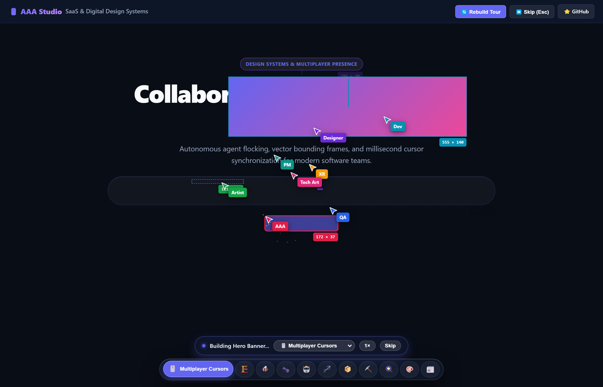
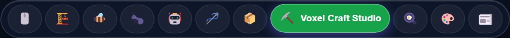
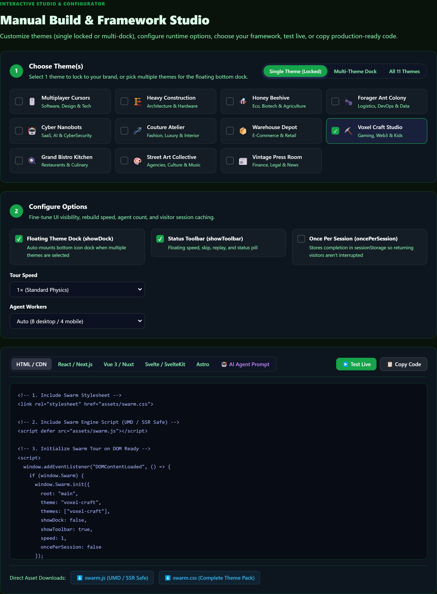
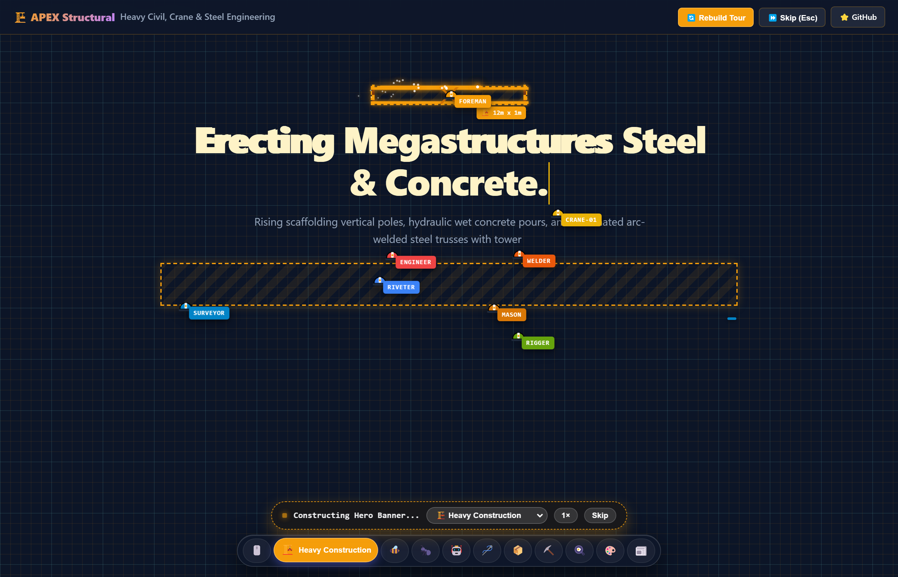
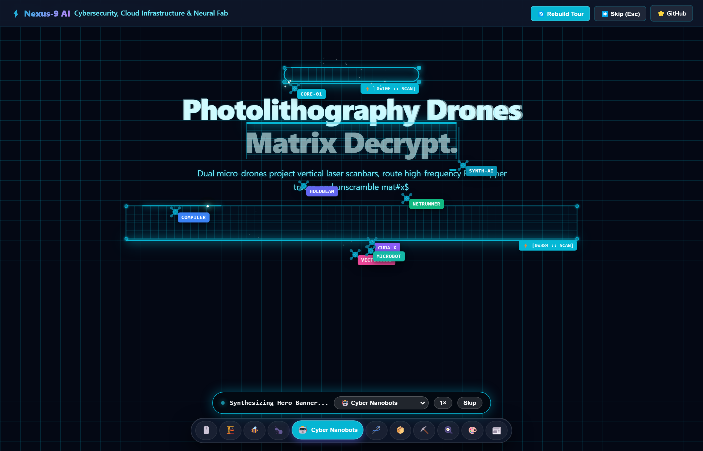
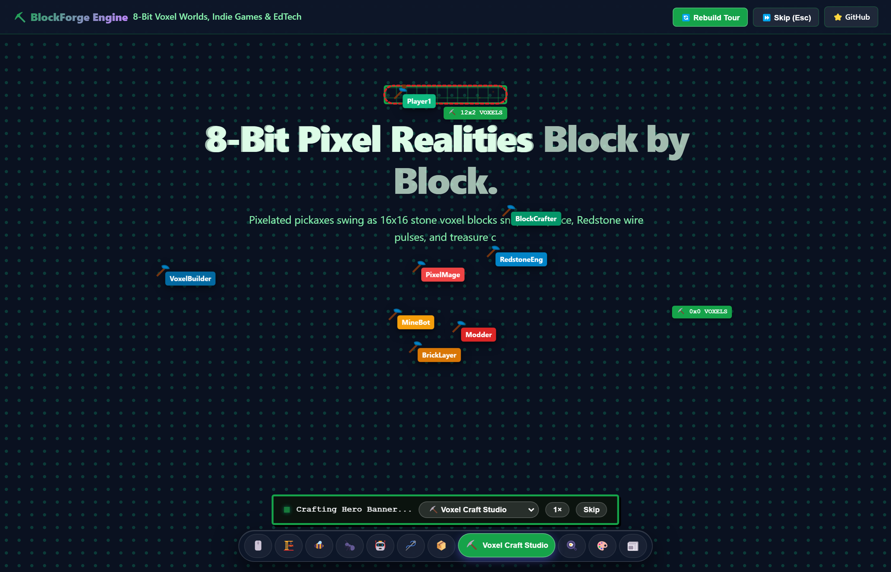

# AAA Swarm 🐝 — Multiplayer "Page Rebuild" Guided Tour

An interactive, high-impact multiplayer cursor rebuild experience for websites, inspired by Dhvanil Patel's iconic portfolio tour. 

A collaborative flock of labeled agent cursors (`Designer`, `Dev`, `AAA`, `Artist`, `PM`, `3D`, `XR`, etc.) works in real time to assemble your web page piece by piece over a blueprint dot matrix background. The camera smoothly guides visitors down section by section as each is constructed, then glides back to the top once finished.

Zero external dependencies. Pure vanilla JavaScript and CSS.

---

## 🎬 Live Showcase

Experience autonomous agent swarms assembling websites piece-by-piece in real time:



### 🛸 Floating Bottom Theme Switcher Dock
Hover any icon to reveal its industry label; click to instantly rebuild the entire page in that theme's physical choreography:



* **Interactive Live Demo**: Open `index.html` locally or visit GitHub Pages.

---

## 🛠️ Interactive Configurator & Manual Builder Studio

Want to customize themes or build manually? The demo includes a built-in interactive configurator studio (`#integration`) that generates copy-paste ready code for any stack:



- **1 or Many Themes Picker**: Toggle between **Single Locked Theme** (hides theme switcher for a pristine branded experience), **Multi-Theme Dock** (pick 2–11 themes), or **All 11 Themes**.
- **Fine-Grained Runtime Options**: Toggle floating dock, status toolbar HUD, run once-per-session (`sessionStorage`), speed multipliers (1× / 2× / 3×), and agent worker count.
- **6 Framework Code Generators**: Instant drop-in snippets for **Vanilla HTML / CDN**, **React / Next.js**, **Vue 3 / Nuxt 3**, **Svelte / SvelteKit**, **Astro**, and **🤖 AI Agent Prompt**.
- **Test Live**: Click `▶️ Test Live` to immediately preview your custom options right on the demo page.
- **1-Click Downloads**: Direct links to download standalone `swarm.js` and `swarm.css`.

---

## 🎨 11 Authentic Industry Themes

Each theme features completely bespoke physical construction choreographies, custom vector tools, particle sparks, and sound effects:

### 1. Heavy Construction & Engineering (`construction`)
Scaffolding vertical poles, blowtorch welder sparks, hydraulic concrete pour, and crane cargo crate drops:


### 2. AI, Cloud & Cybersecurity (`cyber-nanobots`)
Micro-drones with dual vertical laser scanbars, PCB copper traces with solder pads, and Matrix hex decryption:


### 3. Voxel Craft & Gaming (`voxel-craft`)
Pixelated pickaxes swinging as 16x16 voxel blocks snap with physics bounce, Redstone wire border glow, and treasure chest unpacks:


---

## ✨ Features

- **🎨 Multi-Theme Rebuild Framework**: Switch instantly between digital product UI design cursors (`default`) and heavy industrial builders (`construction`), or plug in custom themes with `Swarm.registerTheme()`.
- **📐 CAD Blueprint & Hazard Stripe Canvas**: Authentic blueprint grid background with metric scales, technical stamps, and perimeter hazard warning stripes (`#f59e0b` / `#1e293b`).
- **🛠️ 5 Complete Physical Assembly Phases (Radically Customized Across 11 Themes)**:
  - **`dragBox` (Layout Framing)**: Rising scaffolding vertical poles (`construction`), figure-8 honeycomb wax bloom (`beehive`), pheromone trench haul (`ant-colony`), dual drone laser scanbar sweep (`cyber-nanobots`), fabric bolt unroll (`atelier`), kraft tape carton dispensing (`warehouse`), voxel tile pop (`voxel-craft`), rolling pin dough flattening (`kitchen`), diagonal wheatpaste strokes (`street-art`), movable-type chase frame clamp (`press-room`).
  - **`traceBorder` (Perimeter Sealing)**: White-hot welder blowtorch sparks (`construction`), dripping amber honey droplets (`beehive`), marching ant mandible wall (`ant-colony`), PCB copper routing with solder pads (`cyber-nanobots`), needle running stitches with silk thread (`atelier`), barcode scanner sweep + FRAGILE stamp (`warehouse`), redstone wire glow (`voxel-craft`), fluted pastry cream piping (`kitchen`), aerosol neon spray with vertical paint runs (`street-art`), fountain pen ruling with corner crop-marks ┼ (`press-room`).
  - **`fillBox` (Surface Solidify)**: Hydraulic wet concrete pour, liquid amber honey crystallization, leaf & soil tile packing, Matrix glitch voxel materialize, silk cloth drape down, 3D cardboard flaps folding, 16x16 pixel block stack, kitchen blowtorch caramelization, squeegee poster press, ink brayer roller sheet sweep.
  - **`typeText` (Letterform Inscription)**: Matrix hex-decrypt character scrambler (`0x8F#$`), scout bee waggle dance depositing pollen, ant letter token delivery, monogram embroidery needle bob, chocolate syrup drizzle, mechanical typewriter hammer punch with ribbon flash, 8-bit RPG text ticker, industrial stencil spray.
  - **`dropImage` (Media Unpacking)**: 11 distinct custom unpackers: tower crane wooden crate shatter, honeycomb wax cap unseal, 8-ant heavy cargo lift, laser 3D hologram sinter sweep, Polaroid moodboard photo + brass pushpin, forklift pallet delivery, pixel treasure chest with golden glow, silver cloche dome steam lift, slap-sticker angle slam & squeegee, CMYK 4-color halftone plate alignment.
- **🎥 Guided Scroll-Follow Camera**: Automatically scrolls the viewport to each `<section>` as it begins construction, guaranteeing visitors never miss the animation offscreen.
- **🔝 Automatic Glide Back to Top**: Once all sections are fully assembled, smoothly animates the camera back to `(0, 0)` so visitors can browse normally.
- **⚡ Speed Toggle & Instant Skip**:
  - Floating pill toolbar showing live status (e.g., *"Constructing Core Features..."*).
  - Speed toggle: `1×` / `2×` / `3×`.
  - Instant **Skip** button (`Esc` key) to unveil everything immediately without waiting.
  - **Replay** trigger (`Alt + Shift + S`) to restart the rebuild anytime.
- **🛡️ Zero-Reflow DOM Snapshotting**: Original DOM elements remain rendered in place with original geometry (`boundingClientRect`), but hidden via `.swarm-pending`. No layout shift or jumpy repaints.
- **♿ Accessibility Built-in**: Automatically respects `prefers-reduced-motion` by disabling cursors and revealing all content instantly.

---

## 📁 Project Structure

```text
aaa-swarm/
├── index.html            # Production showcase demo & interactive builder studio
├── .nojekyll             # Direct GitHub Pages static deployment guard
├── assets/
│   ├── swarm-preview.png # Live hero tour screenshot with multiplayer cursors
│   ├── demo-builder-studio.png # Interactive manual builder & code generator
│   ├── demo-theme-dock.png     # Floating bottom icon dock with hover reveal
│   ├── demo-theme-construction.png # Scaffolding, blowtorches & crane mechanics
│   ├── demo-theme-cyber.png        # Dual laser scanbars & Matrix hex decrypt
│   ├── demo-theme-voxel.png        # 16x16 voxel snap, redstone wire & treasure chest
│   ├── swarm.css         # Complete 11-theme stylesheets & CAD blueprint grid
│   └── swarm.js          # UMD/SSR-safe tour engine & multi-agent physics
├── SKILL.md              # Open Agent Skills standard specification (Claude Code, Codex, Antigravity)
├── AGENTS.md             # Multi-agent guideline specification (OpenCode, Codex, Aider)
└── README.md             # Project guide and documentation
```

---

## 🤖 Universal AI Agent Compatibility

`aaa-swarm` is built on the open **Agent Skills specification** (`SKILL.md` format), making it natively cross-compatible with all major AI coding agents:

| AI Coding Assistant | Configuration Location | How to Invoke |
|---|---|---|
| **Claude Code** (Anthropic) | `~/.claude/skills/aaa-swarm` or `.claude/skills/` | Type `/aaa-swarm` or ask Claude to "add swarm guided tour" |
| **Codex** (OpenAI) | `~/.codex/skills/aaa-swarm` or `.codex/skills/` | Prompt Codex to "implement swarm guided rebuild tour" |
| **OpenCode & OpenHands** | `~/.agents/skills/aaa-swarm` or reads `AGENTS.md` | Auto-detected via skill loader or `AGENTS.md` |
| **Google Antigravity / Gemini** | `~/.gemini/config/skills/aaa-swarm` | Type `/aaa-swarm` |
| **Cursor & Windsurf** | Referenced in `.cursorrules` or `.windsurfrules` | Prompt Composer/Cascade: "implement aaa-swarm tour" |

### ⚡ 1-Liner Installation Across Any Agent

Install globally for your favorite agent:

```bash
# Claude Code (Anthropic)
git clone https://github.com/theaaa-studio/aaa-swarm.git ~/.claude/skills/aaa-swarm

# OpenAI Codex
git clone https://github.com/theaaa-studio/aaa-swarm.git ~/.codex/skills/aaa-swarm

# Google Antigravity / Gemini
git clone https://github.com/theaaa-studio/aaa-swarm.git ~/.gemini/config/skills/aaa-swarm

# OpenCode / OpenHands / Generic Agents
git clone https://github.com/theaaa-studio/aaa-swarm.git ~/.agents/skills/aaa-swarm
```

For project-level skills, drop `aaa-swarm/` into your project's `.claude/skills/`, `.codex/skills/`, or `.agents/skills/` folder. Any AI agent reading your repository will immediately know how to inspect, adapt, and build the tour!

---

## 🚀 Quick Start (2 Minutes)

### 1. Copy Assets into Your Project

Copy `assets/swarm.css` and `assets/swarm.js` into your project's static assets directory:

```bash
# Example directory layout
my-website/
├── css/
│   └── swarm.css
├── js/
│   └── swarm.js
└── index.html
```

### 2. Link in HTML

Include `swarm.css` in your `<head>`:

```html
<!-- Swarm Rebuild Stylesheet -->
<link rel="stylesheet" href="css/swarm.css">
```

Include `swarm.js` before the closing `</body>`:

```html
<!-- Swarm Rebuild Engine -->
<script defer src="js/swarm.js"></script>
```

### 3. Initialize on DOM Ready

Ensure your page sections are structured using `<section>` tags inside `<main>` (or another container root):

```html
<main id="main">
  <section id="hero">
    <h1>Welcome to My Site</h1>
    <p>Designing modern digital experiences.</p>
  </section>

  <section id="about">
    <h2>About Me</h2>
    <div class="card">UX / UI Designer based in Dhaka</div>
  </section>

  <section id="projects">
    <h2>Projects</h2>
    <div class="project-card">Project One</div>
    <div class="project-card">Project Two</div>
  </section>
</main>

<script>
  window.addEventListener("DOMContentLoaded", function () {
    // Optional short delay (e.g. 100ms) to allow WebGL / fonts to settle baseline geometry
    setTimeout(function () {
      if (window.Swarm) {
        // Available themes: "default" | "construction"
        window.Swarm.init({ root: "main", agents: 10, theme: "construction" });
      }
    }, 100);
  });
</script>
```

---

## 🕹️ Public API & Configuration Options

The engine attaches a global `window.Swarm` object and exports UMD/CJS modules:

| Method / Option | Type | Default | Description |
|---|---|---|---|
| `Swarm.init(options)` | `Object` | `{}` | Initializes run, snapshots DOM, starts guided scroll tour. Returns `{ run, destroy }` |
| `options.root` | `string \| HTMLElement` | `"main"` | Selector or DOM element (React `useRef.current` / Vue `ref.value`) |
| `options.theme` | `string` | `"default"` | Active starting theme ID |
| `options.themes` | `Array<string>` | `null` (All) | Array of enabled themes. **If only 1 theme, site is locked and theme switcher dock is hidden!** |
| `options.showDock` | `boolean \| "auto"` | `"auto"` | Floating bottom icon dock (`true`, `false`, or `"auto"`: shown when >1 theme) |
| `options.showToolbar` | `boolean` | `true` | Floating status / speed / skip pill |
| `options.speed` | `1 \| 2 \| 3` | `1` | Initial speed multiplier |
| `options.agents` | `number` | `8` (desk) / `4` (mob) | Worker cursor agents count |
| `options.oncePerSession` | `boolean` | `false` | When `true`, saves completion in `sessionStorage` and skips on subsequent visits |
| `options.sectionSelector` | `string` | `"section, [data-swarm-section]"` | Selector for tour sections |
| `options.onComplete` | `Function` | `null` | Callback executed when tour returns to top |
| `Swarm.destroy()` | `Function` | *None* | Tears down active run, removes overlays, canvases, docks, and event listeners |
| `Swarm.play(options)` | `Function` | `opts` | Alias for `init(options)` |
| `Swarm.setTheme(name)` | `Function` | `name` | Switches active theme and restarts tour |
| `Swarm.getTheme()` | `Function` | *None* | Returns active theme identifier |
| `Swarm.getThemes()` | `Function` | *None* | Returns array of available themes |
| `Swarm.skip()` | `Function` | *None* | Cancels tour, unveils all pending elements, restores regular browsing |
| `Swarm.replay(options)` | `Function` | `opts` | Cleans up current run, scrolls to top, and runs fresh tour with options |
| `Swarm.triggerSectionById(id)` | `Function` | `sectionId` | Jumps tour directly to a specific section by element ID |
| `Swarm.isRunning()` | `Function` | *None* | Returns `true` if tour/rebuild is actively in progress |

### ⌨️ Keyboard Shortcuts

- **`Escape`**: Instantly skips the animation and unveils all sections.
- **`Alt + Shift + S`**: Restarts the rebuild tour from the top.

---

## 🔄 Adding a "Rebuild Tour" Button

You can place a replay button anywhere in your navigation dock, mobile menu, or footer:

```html
<!-- Header Navigation or Footer Replay Button -->
<button type="button" class="btn-rebuild" onclick="window.Swarm && window.Swarm.replay()" title="Rebuild Guided Tour (Alt+Shift+S)">
  <i class="fas fa-magic"></i> Rebuild Tour
</button>
```

---

## ⚙️ Customization

### 1. Custom Agent Names and Colors

Open `assets/swarm.js` and modify the `NAMES` and `COLORS` arrays at lines 23–24:

```javascript
const NAMES = [
  "Designer", "Dev", "AAA", "Artist", "XR", 
  "QA", "Tech Art", "PM", "Frontend", "3D"
];

const COLORS = [
  "#6d28d9", // Purple
  "#0891b2", // Cyan
  "#e11d48", // Rose
  "#16a34a", // Green
  "#f59e0b", // Amber
  "#2563eb"  // Blue
];
```

### 2. Friendly Section Names in the Status Pill

`swarm.js` includes a `friendlyName(section)` helper that determines what text appears in the floating progress pill (e.g. *"Building About..."*).

It automatically checks:
1. Hardcoded ID lookups (`home` → *"Hero"*, `technology` → *"Tech Stack"*).
2. The section's `aria-label` attribute.
3. The first `<h1>`, `<h2>`, or `<h3>` heading inside the section.
4. Falls back to formatting the element ID.

You can add custom aliases directly:

```javascript
function friendlyName(section) {
  const id = section.id || "";
  if (id === "case-studies") return "Client Case Studies";
  if (id === "pricing") return "Plans & Pricing";
  // ...
}
```

### 3. Exclude Specific Elements from Being Hidden

If there are elements that must **always** remain visible during the tour (e.g., a sticky navigation bar or fixed background audio player), ensure they live **outside** the `<main>` root passed to `Swarm.init({ root: "main" })`, or add CSS:

```css
.my-fixed-navbar {
  z-index: 10001 !important;
  opacity: 1 !important;
  pointer-events: auto !important;
}
```

---

## ⚛️ Framework Integration

### React / Next.js (App Router or Pages)

```tsx
"use client";

import { useEffect } from "react";
import Script from "next/script";

export default function Page() {
  useEffect(() => {
    const handleLoaded = () => {
      if (typeof window !== "undefined" && (window as any).Swarm) {
        (window as any).Swarm.init({ root: "main", agents: 8 });
      }
    };

    window.addEventListener("DOMContentLoaded", handleLoaded);
    // If already loaded:
    if (document.readyState === "complete") handleLoaded();

    return () => {
      if (typeof window !== "undefined" && (window as any).Swarm?.isRunning()) {
        (window as any).Swarm.skip();
      }
    };
  }, []);

  return (
    <>
      <link rel="stylesheet" href="/css/swarm.css" />
      <Script src="/js/swarm.js" strategy="afterInteractive" />

      <main id="main">
        <section id="hero">...</section>
        <section id="work">...</section>
      </main>
    </>
  );
}
```

### Vue 3 / Nuxt

```vue
<script setup>
import { onMounted, onBeforeUnmount } from "vue";

onMounted(() => {
  if (window.Swarm) {
    window.Swarm.init({ root: "main" });
  }
});

onBeforeUnmount(() => {
  if (window.Swarm?.isRunning()) {
    window.Swarm.skip();
  }
});
</script>
```

---

## 🧠 Architectural Principles

When extending or maintaining this project:

1. **Sequential Guided Scroll vs Blind Viewport Queueing**:
   - `runTour()` sequentially scrolls each `<section>` into view, waits for the viewport arrival transition (`~400ms`), and only then builds that section.
   - Never use blind `IntersectionObserver` triggers with auto-scroll: tall screens (1440p+) or fast monitors would trigger lower sections prematurely before the viewer scrolls down.
2. **Exclude Layout Containers**:
   - Container elements (`.container`, `.row`, `.col`, `.grid`, `.wrapper`) are omitted from snapshot card-drawing to avoid drawing massive empty frames that block child components.
3. **Pacing and Velocity**:
   - Agent travel speed is scaled: `2200px/s * getSpeed()`.
   - Box drag duration: `90ms - 190ms`.
   - Pen border duration: `100ms - 210ms`.
   - Typewriter typing duration: `65ms - 250ms`.

---

## 📄 License

MIT License. Free to use, customize, and port to any personal, commercial, or open-source web application. Inspired by Dhvanil Patel's creative portfolio interactions.
